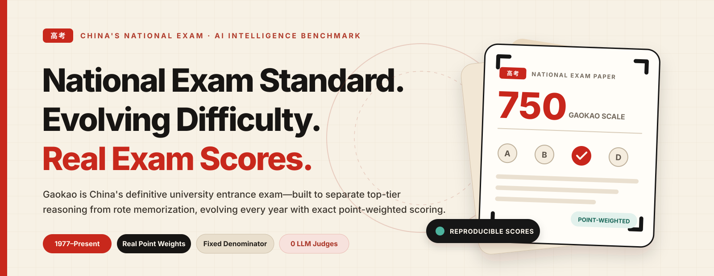
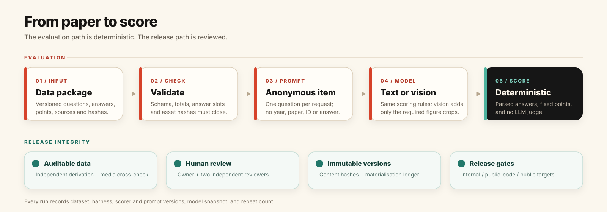

<p align="center">
  <picture>
    <source media="(prefers-color-scheme: dark)" srcset=".github/readme/logo-dark.svg">
    
  </picture>
</p>

<h1 align="center">Gaokao-Bench</h1>

<p align="center"><strong>National Exam Standard · Evolving Difficulty · Real Exam Scores</strong></p>

<p align="center">An AI intelligence benchmark built on China's National College Entrance Examination (Gaokao).<br>Point-weighted, deterministic, and designed to track true reasoning ability across decades of real exams.</p>

<p align="center">English&nbsp;&nbsp;·&nbsp;&nbsp;<a href="README.zh-CN.md">简体中文</a></p>

<p align="center">
  <a href="https://www.python.org/"></a>
  <a href="CITATION.cff"></a>
  <a href="#scoring-rules"></a>
  <a href="https://huggingface.co/datasets/Knove/Gaokao-Bench"></a>
</p>

<p align="center">
  <a href="#why-gaokao-as-an-ai-intelligence-benchmark"><strong>Why Gaokao-Bench</strong></a> &nbsp;·&nbsp;
  <a href="#dataset-overview"><strong>Dataset</strong></a> &nbsp;·&nbsp;
  <a href="#how-it-works"><strong>How It Works</strong></a> &nbsp;·&nbsp;
  <a href="#quick-start"><strong>Quick Start</strong></a> &nbsp;·&nbsp;
  <a href="#scoring-rules"><strong>Scoring</strong></a> &nbsp;·&nbsp;
  <a href="#roadmap"><strong>Roadmap</strong></a>
</p>

<p align="center">
  <picture>
    <source media="(prefers-color-scheme: dark)" srcset=".github/readme/hero-dark.svg">
    
  </picture>
</p>

## Why Gaokao as an AI Intelligence Benchmark?

**Gaokao (China's National College Entrance Examination)** offers a uniquely rigorous, real-world ruler for evaluating AI intelligence:

1. **A High-Stakes National Standard:** Taken by over ten million students every year, Gaokao is China's definitive university entrance exam. Every question is crafted by top national subject panels to separate deep multi-step reasoning from surface-level guesswork. Its scores carry clear, widely understood real-world meaning.
2. **Dynamically Evolving & Anti-Rote:** Gaokao is not a static question bank. New national and provincial papers are created every year, and the exam's design continuously evolves to penalize rote memorization and template-matching in favor of novel problem-solving. Tracking models across Gaokao years reveals whether AI is genuinely reasoning or merely memorizing patterns.
3. **Graded Like a Real Exam:** Many exam benchmarks treat all questions equally by reporting raw item accuracy, rely on another LLM to judge outputs, and quietly drop failed API calls from the denominator. **Gaokao-Bench** enforces real exam grading:
   - **Real Point Weights:** Questions are weighted by their actual exam points, not raw item count.
   - **Zero LLM Judges:** Purely deterministic math parsers and canonical validators—no LLM judge noise in the scoring loop.
   - **Fixed Denominators:** Timeouts, API errors, and malformed outputs score `0`. The total possible points never shrink.
   - **Anonymized Prompts:** Year, paper name, and question numbers are stripped from prompts so models cannot shortcut via metadata.

> [!NOTE]
> This repository contains the evaluation harness, deterministic scorer, and verification tools. Exam datasets are published separately on [Hugging Face](https://huggingface.co/datasets/Knove/Gaokao-Bench) and pinned by version tag (see [`SCOPE.md`](SCOPE.md)).

## Dataset Overview

The initial `0.0.1` release covers the objective sections of the **2025 Gaokao Mathematics** papers, verified through independent derivations and two-person blind review:

| Metric | `0.0.1` Scope |
| --- | --- |
| **Subject & Year** | 2025 · Mathematics |
| **Exam Papers** | 5 papers (National I, National II, Beijing, Shanghai, Tianjin) |
| **Scored Questions** | **74** (39 single-choice, 6 multiple-choice, 29 fill-in-the-blank) |
| **Total Points** | **353 points** across **78** answer slots |
| **Figure-dependent Questions** | **4** items |
| **Text Mode** | **70 items / 334 reachable points** (denominated over 353) |
| **Vision Mode** | **74 items / 353 points** (includes the 4 cropped figures) |
| **Distribution** | [Hugging Face dataset](https://huggingface.co/datasets/Knove/Gaokao-Bench), revision `v0.0.1` |

*Note: The 353-point denominator is the exact sum of the objective questions across the 5 papers, without linear extrapolation to a 750-point full exam score.*

## How It Works

<p align="center">
  <picture>
    <source media="(prefers-color-scheme: dark)" srcset=".github/readme/pipeline-dark.svg">
    
  </picture>
</p>

1. **Anonymized Prompting:** The harness sends one question at a time to the model without metadata (no year, region, or question ID) and requests a structured JSON answer.
2. **Deterministic Parsing:** Responses are normalized (handling fractions, radicals, intervals, sets, LaTeX expressions, and choice combinations) and matched against canonical answer keys.
3. **Multi-Reviewer Verification:** Before any dataset version is frozen, every item passes source registration, independent solution derivation, point verification, and two-reviewer sign-off.

## Quick Start

### 1. Install

Requires Python 3.9+.

```bash
git clone <repository-url>
cd gaokao-bench

python3 -m venv .venv
source .venv/bin/activate
python -m pip install --upgrade pip
python -m pip install -e ".[dev]"

python -m pytest -q
```

If you only need the runtime harness and dataset downloader without test tools, install `.[harness,data]`.

### 2. Prepare the Dataset

Download the immutable public release from Hugging Face and verify every file hash:

```bash
python -m pip install -e ".[data]"
gaokao-bench fetch-data --version 0.0.1

export GB_DATA=data/0.0.1
gaokao-bench validate --data-dir "$GB_DATA"
```

The command downloads revision `v0.0.1` into `data/0.0.1`, removes Hugging Face cache metadata, and refuses to trust an unverified or unrelated directory. If you prefer to download manually:

```bash
python - <<'PY'
from huggingface_hub import snapshot_download
snapshot_download(
    repo_id="Knove/Gaokao-Bench",
    repo_type="dataset",
    revision="v0.0.1",
    local_dir="data/0.0.1",
)
PY
gaokao-bench validate --data-dir data/0.0.1
```

`GB_DATA` points at the version directory, not the repository root. Do not mix files from different dataset versions.

### 3. Score an Existing Submission

If you already have model predictions, format them by question ID:

```json
{
  "answers": {
    "<question-id>": "C",
    "<multi-choice-id>": "ACD",
    "<two-slot-fill-id>": ["2", "π/4"]
  }
}
```

Run the evaluator:

```bash
gaokao-bench evaluate --data-dir "$GB_DATA" --answers submission.json
```

### 4. Run a Full Model Evaluation

Set your API key and run the harness across the dataset. By default, we recommend running at `temperature=0` with 3 repeats:

```bash
export OPENAI_API_KEY=...

python3 scripts/run_benchmark.py \
  --data-dir "$GB_DATA" \
  --provider openai_compatible \
  --model "<model-snapshot>" \
  --api-key-env OPENAI_API_KEY \
  --modality vision \
  --repeats 3 \
  --temperature 0 \
  --output-dir runs/<run-id>
```

Built-in providers include `openai_compatible`, `anthropic`, `gemini_cli`, and `mock`. Pass `--prepare-only` to inspect the generated prompts without calling an API.

## Scoring Rules

$$\text{Score} = \frac{\text{Earned Points}}{\text{Fixed Total Points (353)}}$$

- **Exact Match per Question:** In `0.0.1`, multi-select and multi-blank questions are all-or-nothing. Every slot must match to earn the question's points.
- **No Dropped Samples:** Missing outputs, JSON format errors, timeouts, and API failures are recorded and scored as `0`.
- **Text vs. Vision Profiles:** Both profiles are evaluated against the same 353-point denominator. In `text` mode, the 4 figure-dependent questions are skipped and scored `0` (capping the reachable score at 334/353). In `vision` mode, the cropped figures are attached for those 4 questions.
- **Contamination & Freshness Tracking:** Publicly available historical papers are explicitly tagged (e.g., `retrospective_public_2025`) to distinguish them from zero-contamination evaluations conducted immediately upon each new June Gaokao release.

## Roadmap

Our long-term goal is to build a **complete, high-precision archive covering every Gaokao paper since the exam's restoration in 1977**, providing a longitudinal benchmark for AI intelligence:

### Phase 1: Core Infrastructure & 2025 Baseline (Completed)
- [x] **v0.0.1 — 2025 Mathematics Objective Baseline:** 5 papers (National I, National II, Beijing, Shanghai, Tianjin; 74 items / 353 points) with text & vision profiles, deterministic math parsing, and two-reviewer verification.

### Phase 2: 10-Year Expansion & All-Subject Objective Coverage (In Progress)
- [ ] **2015–2024 Mathematics Archive:** Full coverage of the past decade of national and provincial Mathematics papers to track model performance across shifting exam difficulty.
- [ ] **All Gaokao Subjects:** Expand deterministic, point-audited evaluation to Physics, Chemistry, Biology, Chinese, English, History, Geography, and Politics.
- [ ] **Official Partial-Credit Rules:** Support official provincial partial-credit rules for multiple-choice and multi-blank questions.

### Phase 3: Complete Historical Gaokao Archive (1977–Present) (Planned)
- [ ] **1977–2014 Historical Papers:** Digitize, audit, and verify all national and provincial Gaokao papers since the restoration of the exam in 1977—building a nearly half-century collection of national entrance exams.
- [ ] **Longitudinal AI Intelligence Studies:** Analyze how models handle the decades-long evolution of Gaokao problem design, from classic algebraic derivation to modern anti-template modeling.

### Phase 4: Full 750-Point Exam & Live Annual Evaluation (Ongoing)
- [ ] **Subjective & Step-by-Step Grading:** Introduce rubric-aligned step verification, formal proof checking, and human-in-the-loop adjudication to cover full 750-point papers.
- [ ] **Annual June "Live Gaokao" Evaluation:** Benchmark frontier models immediately after each June Gaokao before new questions enter pre-training corpora.

## Project Structure

| Directory / File | Description |
| --- | --- |
| `gaokao_bench/` | Core scorer, math expression parsers, evaluation harness, and data verification logic |
| `scripts/` | CLI scripts for dataset validation, scoring, model runs, and release checks |
| `scripts/build_public_data.py` | Build and sanitize the Hugging Face data package |
| `scripts/upload_hf_data.py` | Validate, upload, and tag a public dataset release |
| `tests/` | Unit tests for math parsing, scoring rules, and bundle verification |
| `SCOPE.md` | Details on code/data separation and benchmark methodology |
| `CITATION.cff` | Citation metadata |
| [Hugging Face](https://huggingface.co/datasets/Knove/Gaokao-Bench) | Versioned objective-question data package |

## Contributing

Issues and PRs—whether contributing historical paper sources, fixing parser edge cases, or adding provider adapters—are very welcome!

- Run `python -m pytest -q` and add unit tests for any parser or scorer changes.
- Keep `README.md` and `README.zh-CN.md` in sync when updating CLI usage or features.
- Do not include unreviewed exam text, PDFs, or images in code pull requests.

## Citation

If you find Gaokao-Bench useful in your research or evaluations, please cite:

```bibtex
@software{gaokao_bench_2026,
  author       = {{Gaokao-Bench contributors}},
  title        = {Gaokao-Bench},
  year         = {2026},
  version      = {0.0.1},
  url          = {https://huggingface.co/datasets/Knove/Gaokao-Bench}
}
```
