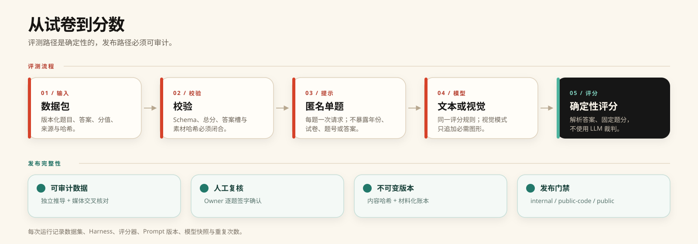

<p align="center">
  <picture>
    <source media="(prefers-color-scheme: dark)" srcset=".github/readme/logo-dark.svg">
    
  </picture>
</p>

<h1 align="center">Gaokao-Bench</h1>

<p align="center"><strong>全国选拔标尺 · 历年动态演进 · 真实卷面评测</strong></p>

<p align="center">以中国高考历年真题为核心的 AI 智力评测基准。<br>还原真实卷面分值与确定性判分，追踪大模型在国家级高区分度考题上的真实水位。</p>

<p align="center"><a href="README.md">English</a>&nbsp;&nbsp;·&nbsp;&nbsp;简体中文</p>

<p align="center">
  <a href="https://www.python.org/"></a>
  <a href="CITATION.cff"></a>
  <a href="#计分规则"></a>
  <a href="https://huggingface.co/datasets/Knove/Gaokao-Bench"></a>
</p>

<p align="center">
  <a href="#为什么选择高考作为-ai-智力标尺"><strong>为什么做 Gaokao-Bench</strong></a> &nbsp;·&nbsp;
  <a href="#数据集概览"><strong>数据集概览</strong></a> &nbsp;·&nbsp;
  <a href="#评测流程"><strong>评测流程</strong></a> &nbsp;·&nbsp;
  <a href="#快速上手"><strong>快速上手</strong></a> &nbsp;·&nbsp;
  <a href="#计分规则"><strong>计分规则</strong></a> &nbsp;·&nbsp;
  <a href="#路线图-roadmap"><strong>路线图</strong></a>
</p>

<p align="center">
  <picture>
    <source media="(prefers-color-scheme: dark)" srcset=".github/readme/hero-zh-dark.svg">
    
  </picture>
</p>

## 为什么选择高考作为 AI 智力标尺？

**中国高考（普通高等学校招生全国统一考试）** 是一把天然且极高含金量的智力标尺：

1. **极具代表性的国家级选拔尺度：** 高考是中国每年上千万考生进入大学的必经选拔考试，每一道题都经过顶尖命题专家的反复打磨，专门为了拉开思维层次、检验多步严密推理而设计。考卷上的每一分，在现实世界都有极其明确的认知含金量与全社会共识。
2. **随时代动态演进，拒绝套路化：** 高考不是静态题库。每年都有全新的全国卷与省市自主命题卷诞生，且命题趋势一直在动态升级——近年更是持续强化“反刷题、反套路”的创新情境与跨模块综合考查。这种天然的年度演进与难度跃迁，正好可以用来持续追踪 AI 智力的真实上限，区分模型到底是在“背题库”还是在“真推理”。
3. **像真正批改高考试卷一样做评测：** 目前不少考试类 Benchmark 习惯把不同分值的题目按“答对题数百分比”一视同仁，用另一个大模型当裁判打分，甚至在接口报错时悄悄把失败样本从分母里删掉。**Gaokao-Bench** 严格还原高考阅卷逻辑：
   - **真实卷面分值：** 每道题按高考卷面实际分值加权，告别“大小题同权”。
   - **零裁判模型确定判分：** 纯确定性数学解析与规则校验，不引入 LLM 裁判噪声。
   - **固定总分分母：** 请求超时、API 报错或格式解析失败一律记 `0` 分，总分分母绝不缩水。
   - **匿名防泄露：** 发送给模型的 Prompt 自动剥离年份、卷种与题号，防止模型靠元信息投机。

> [!NOTE]
> 本仓库提供评测框架（Harness）、确定性判分器与数据校验工具。真题数据包发布在 [Hugging Face](https://huggingface.co/datasets/Knove/Gaokao-Bench)，通过版本标签固定（详见 [`SCOPE.md`](SCOPE.md)）。

> [!IMPORTANT]
> 从数据版本 `0.0.3` 起，整个数据包采用 **CC BY 4.0**，包括题面、答案、题图、题目编排、schema 和评分元数据。第三方可以复制、改编和商业使用，但必须署名。公开 manifest 同时设置 `public_ranking_allowed=true`；发布公开榜单和模型对比时，需要注明数据版本与评测协议，且不得暗示项目背书。更早的不可变标签保留其发布时声明的条款。

## 数据集概览

当前 `0.0.3` 是 `0.0.2` 的授权更新，题目内容相同，收录 **2025 年高考数学** 5 套试卷的全部客观题，整个数据包改为 CC BY 4.0，并允许公开榜单和模型对比：

| 维度 | `0.0.3` 数据规格 |
| --- | --- |
| **年份与科目** | 2025 · 数学 |
| **覆盖试卷** | 5 套（全国一卷、全国二卷、北京卷、上海卷、天津卷） |
| **计分题量** | **74 题**（单选 39 题、多选 6 题、填空 29 题） |
| **卷面总分** | **353 分**（共 **78** 个答案空位） |
| **含图题目** | **4 题** |
| **纯文本模式（Text）** | 实际作答 **70 题 / 满分上限 334 分**（仍以 353 分为总分母） |
| **多模态模式（Vision）** | 完整作答 **74 题 / 353 分**（对 4 道含图题附带原题裁图） |
| **数据许可** | **CC BY 4.0** |
| **分发地址** | [Hugging Face 数据集](https://huggingface.co/datasets/Knove/Gaokao-Bench)，版本 `v0.0.3` |

*注：353 分是 5 套试卷客观题真实分值的累加，不会按线性比例虚构折算成 750 分总分。*

## 评测流程

<p align="center">
  <picture>
    <source media="(prefers-color-scheme: dark)" srcset=".github/readme/pipeline-zh-dark.svg">
    
  </picture>
</p>

1. **匿名化提问：** 评测框架逐题独立请求模型，隐去试卷年份、地区、题号等元信息，仅要求模型返回结构化 JSON 答案。
2. **确定性判分：** 解析器对模型输出做数学规范化处理（支持分数、根式、区间、集合、LaTeX 公式及多选组合），直接与标准答案比对。
3. **多轮盲审固化：** 每个数据集版本在发布前，均需完成来源登记、独立解题推导、卷面分值核对以及两名审校员的独立复核签字。

## 快速上手

### 1. 安装环境

需要 Python 3.9 及以上版本：

```bash
git clone <repository-url>
cd gaokao-bench

python3 -m venv .venv
source .venv/bin/activate
python -m pip install --upgrade pip
python -m pip install -e ".[dev]"

python -m pytest -q
```

如果只需要运行评测和下载数据，不需要开发测试工具，安装 `.[harness,data]` 即可。

### 2. 准备数据包

从 Hugging Face 下载不可变版本，并逐文件校验哈希：

```bash
python -m pip install -e ".[data]"
gaokao-bench fetch-data --version 0.0.3

export GB_DATA=data/0.0.3
gaokao-bench validate --data-dir "$GB_DATA"
```

命令会下载 `v0.0.3` 到 `data/0.0.3`，清理 Hugging Face 缓存元数据，并拒绝使用未通过校验或不属于该仓库的目录。也可以手动下载：

```bash
python - <<'PY'
from huggingface_hub import snapshot_download
snapshot_download(
    repo_id="Knove/Gaokao-Bench",
    repo_type="dataset",
    revision="v0.0.3",
    local_dir="data/0.0.3",
)
PY
gaokao-bench validate --data-dir data/0.0.3
```

`GB_DATA` 指向具体的版本目录，而不是仓库根目录。不要混用不同版本的文件。

### 3. 对已有作答结果判分

如果你已经通过自己的推理框架拿到了模型输出，可以整理成以题目 ID 为键的 JSON 文件：

```json
{
  "answers": {
    "<question-id>": "C",
    "<multi-choice-id>": "ACD",
    "<two-slot-fill-id>": ["2", "π/4"]
  }
}
```

直接运行本地判分：

```bash
gaokao-bench evaluate --data-dir "$GB_DATA" --answers submission.json
```

### 4. 运行完整模型评测

配置好模型的 API Key 后，即可启动端到端评测。默认建议在 `temperature=0` 下重复运行 3 次：

```bash
export OPENAI_API_KEY=...

python3 scripts/run_benchmark.py \
  --data-dir "$GB_DATA" \
  --provider openai_compatible \
  --model "<model-snapshot>" \
  --api-key-env OPENAI_API_KEY \
  --modality vision \
  --repeats 3 \
  --temperature 0 \
  --output-dir runs/<run-id>
```

内置支持 `openai_compatible`、`anthropic`、`gemini_cli` 和 `mock` 四种调用方式。如果只想预览生成的 Prompt 而不实际调用接口，可以加上 `--prepare-only` 参数。

正式运行会记录完整评测协议。建议使用带日期的模型快照、固定 seed，并在接口支持时固定上游 provider：

```bash
python3 scripts/run_benchmark.py \
  --data-dir "$GB_DATA" \
  --provider openai_compatible \
  --model "<带日期模型快照>" \
  --seed 7 \
  --provider-pin "<上游-provider>" \
  --allow-fallbacks false \
  --max-tokens 32768 \
  --reasoning-budget 8192 \
  --resume \
  --output-dir runs/<run-id>
```

`--max-tokens` 是完成 token 上限，在很多模型上包含隐藏推理 token；`--reasoning-budget` 可选，且必须小于 `--max-tokens`。进度事件以 JSON 行输出到 stderr；中断后使用 `--resume` 继续，`--retry-failed` 只在同一协议下重试 provider 错误、运行器错误和截断输出。

## 计分规则

$$\mathrm{score.weighted\_points} = \frac{\text{当前作用域内获得题分}}{\text{当前作用域内可能题分}}$$

- **唯一主指标：** 值为 `0–1` ratio，并带明确作用域（`full_dataset`、`full_view` 或 `selected_subset`）。对外百分比只是 `100 × ratio`，不再同时维护另一套 full-test 分数。完整 `0.0.3` 数据包的作用域分母是 **353 分**。
- **诊断切片：** `slice.text_answerable.weighted_points`、`slice.vision_required.weighted_points` 和 `diagnostic.exact_accuracy` 都是带独立 ID 和分母的次级指标，不替代主指标。
- **单题全对得分：** `0.0.3` 版本暂不启用多选题与多空填空题的部分分，单题所有空位全部匹配才得分。
- **失败样本不剔除：** 漏答、JSON 解析失败、请求超时、API 报错一律记录在案并记 `0` 分。
- **文本与多模态统一分母：** 两种模式均以 353 分为基准分母。在 `text` 模式下，4 道必须看图的题目不会发送给模型，直接记 `0` 分（因此纯文本模式最高可得 334/353 分）；在 `vision` 模式下，这 4 道题会附带对应的题图裁片。
- **失败分类：** provider 错误、运行器错误、解析错误、缺图和输出截断都保留在分母内并分别计数；推理输出被截断不会被悄悄当成普通答错。
- **公开题库与污染区分：** 已公开年份的试卷在评测报告中会明确标注（如 `retrospective_public_2025`），与每年最新高考放榜前的零污染实时评测（Fresh Exam Evaluation）严格区分。

## 路线图（Roadmap）

Gaokao-Bench 的长期目标是构建**覆盖中国高考恢复以来（1977 年至今）全年份、全科目的高精度评测体系**，持续记录 AI 智力随时间演进的轨迹：

### 阶段一：评测基建与最新真题基线（已完成）
- [x] **v0.0.1 — 2025 高考数学客观题基线：** 覆盖全国一卷、全国二卷、北京、上海、天津 5 套试卷（74 题 / 353 分），跑通纯文本与多模态评测、确定性数学解析及双人盲审数据流。

### 阶段二：近十年高考真题扩充与全科客观题覆盖（进行中）
- [ ] **2015–2024 数学真题回溯：** 系统收录近十年新课标卷、全国卷及各自主命题省市数学真题，构建跨年份难度演进对比曲线。
- [ ] **全科目客观题扩展：** 将高标准审校与真实题分评测拓展至物理、化学、生物、语文、英语、历史、地理、政治等全部高考科目。
- [ ] **多选与多空细粒度赋分：** 支持完全贴合各省历年高考阅卷规则的多选题部分分（如漏选得 2 分或 3 分）与多空分步计分。

### 阶段三：1977 年至今中国高考历史全集（规划中）
- [ ] **1977–2014 历年高考真题全量数字化与精校：** 回溯中国恢复高考以来的全部历史统考与分省试卷，打造跨越近半个世纪的国家级考题全集。
- [ ] **历年命题难度与 AI 能力纵向研究：** 分析大模型在不同年代考题风格（从早期重技巧推演到近年重创新情境与反套路建模）下的表现差异。

### 阶段四：全卷 750 分闭环与年度实时评测（长期持续更新）
- [ ] **主观解答题按步给分体系：** 引入贴合高考阅卷细则（Rubric）的步骤拆解、形式化验证与人机协同裁定，打通从客观题到 750 分全卷评测的闭环。
- [ ] **每年 6 月高考实时零污染评测（Live Gaokao）：** 每年高考结束后第一时间完成当届新题收录与盲审，在预训练语料尚未污染的窗口期内检验新一代模型的真实泛化智力。

## 目录结构

| 路径 | 说明 |
| --- | --- |
| `gaokao_bench/` | 判分器、数学表达式解析、评测框架与数据审校核心实现 |
| `scripts/` | 数据校验、离线判分、模型评测与发布检查的命令行入口 |
| `scripts/build_public_data.py` | 构建并脱敏 Hugging Face 数据包 |
| `scripts/upload_hf_data.py` | 校验、上传并创建数据版本标签 |
| `tests/` | 数学解析、计分逻辑与发布包校验的单元测试 |
| `SCOPE.md` | 代码与数据分离策略及评测方法说明 |
| `ARCHITECTURE.md` | Engine / Spec / Data 边界、指标协议与全学科架构 |
| `CITATION.cff` | 引用元数据 |
| [Hugging Face](https://huggingface.co/datasets/Knove/Gaokao-Bench) | 按版本分发的客观题数据包 |

## 参与贡献

非常欢迎提交 Issue 或 PR，无论是补充历年高考真题线索、完善数学表达式解析的边界情况，还是新增模型适配器：

- 修改解析器或计分逻辑时，请补充对应的单元测试并确保 `python -m pytest -q` 全部通过。
- 涉及命令行参数或功能变更时，请同步更新 `README.md` 和 `README.zh-CN.md`。
- 请勿在代码的 Pull Request 中直接提交未审校的真题文本、PDF 或试卷图片。

## 引用

如果 Gaokao-Bench 对你的研究或模型评测有帮助，欢迎引用：

```bibtex
@software{gaokao_bench_2026,
  author       = {{Gaokao-Bench contributors}},
  title        = {Gaokao-Bench},
  year         = {2026},
  version      = {0.0.3},
  url          = {https://huggingface.co/datasets/Knove/Gaokao-Bench}
}
```
